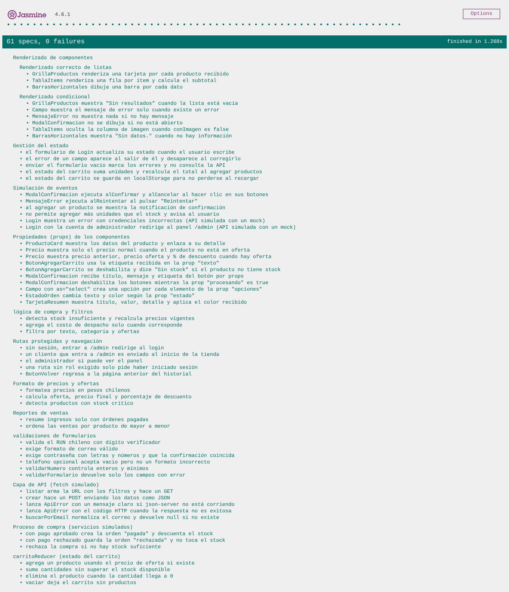
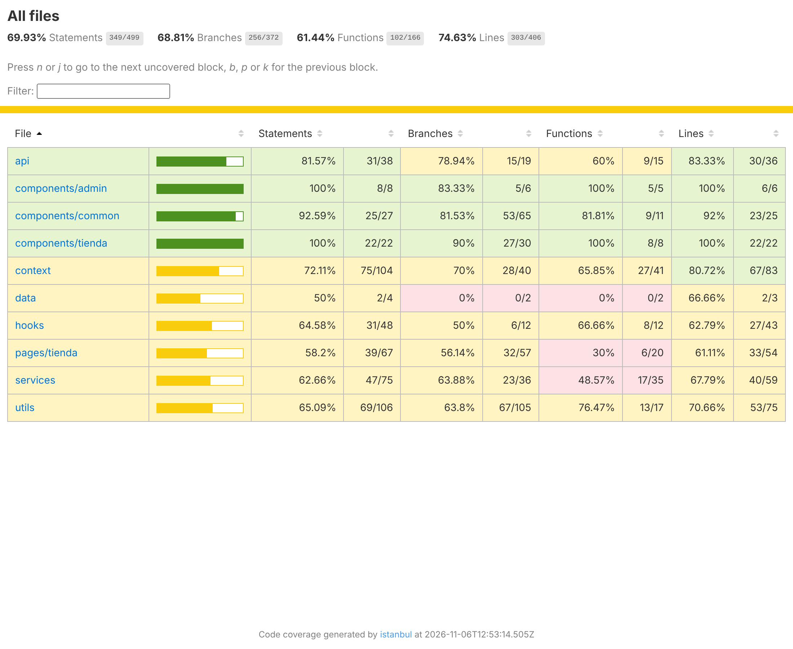

# Documento de cobertura de testing
## The Iron Blade Barbershop — Evaluación Parcial N°2 (DSY1104)

**Equipo:** Nelson Carrasco · Mathias Von Jentschyk
**Fecha:** Noviembre 2026
**Herramientas:** Jasmine 4.6 + Karma 6.4 (navegador Chrome/Chromium headless)

**Resultado:** 61 pruebas · 61 exitosas · 0 fallidas

---

## 1. Propuesta de testing

El objetivo es asegurar que los componentes React de la tienda y del panel de administración funcionen como se espera. Siguiendo la propuesta de pruebas con Jasmine del Anexo 1, las pruebas se organizan en estas categorías:

| Categoría (Anexo 1) | Qué se verifica | Archivo |
|---|---|---|
| **Renderizado correcto** | Los componentes de lista muestran todos los elementos de un conjunto de datos. | `01-renderizado.spec.js` |
| **Renderizado condicional** | Los componentes muestran u ocultan elementos según una condición (por ejemplo, un mensaje de error solo cuando hay error). | `01-renderizado.spec.js` |
| **Propiedades (props)** | Los componentes reciben y usan las props correctas (etiquetas, funciones `onClick`, datos). | `02-propiedades.spec.js` |
| **Estado (state)** | El estado de un formulario cambia cuando el usuario escribe, y el estado del carrito se actualiza. | `03-estado.spec.js` |
| **Eventos** | Se simulan clics y envíos de formularios, y se comprueba que se ejecuten las funciones o cambie la interfaz. | `04-eventos.spec.js` |
| **Mocks de la API** | La capa de datos y el proceso de compra se prueban sin json-server, reemplazando `fetch` y la API por espías. | `05-api-mocks.spec.js` |
| **Lógica de negocio** | Carrito, stock, totales, filtros, validaciones, formatos y reportes. | `06-carrito`, `06-compra`, `07-validaciones`, `08-formato-reportes` |
| **Navegación** | Rutas protegidas por sesión y rol (react-router) y el botón Volver. | `09-rutas.spec.js` |

---

## 2. Configuración del entorno de pruebas

### 2.1 Herramientas

| Herramienta | Versión | Para qué se usa |
|---|---|---|
| **Jasmine** (`jasmine-core`) | 4.6 | Framework de pruebas: `describe`, `it`, `expect`, `beforeEach`, espías (`spyOn`, `jasmine.createSpy`) y pruebas asíncronas (`expectAsync`). |
| **Karma** | 6.4 | Ejecutor de pruebas: levanta un servidor, abre el navegador, ejecuta las pruebas y entrega los resultados. |
| `karma-jasmine` | 5.1 | Conecta Karma con Jasmine. |
| `karma-chrome-launcher` | 3.2 | Abre Chrome (o Chromium/Edge) en modo headless para ejecutar las pruebas en un navegador real. |
| `karma-esbuild` | 2.3 | Compila los archivos de prueba (JSX e `import`) para que el navegador los entienda. |
| `karma-coverage` + `istanbul-lib-instrument` | 2.2 / 6.0 | Mide la cobertura de código. |
| `karma-spec-reporter` | 0.0.37 | Lista cada prueba en la terminal con ✓ o ✗. |
| `karma-jasmine-html-reporter` | 2.1 | Muestra el reporte visual de Jasmine en el navegador. |
| `@testing-library/react` | 16 | Renderiza componentes React dentro de las pruebas y los busca como lo haría un usuario (por texto, rol o etiqueta). |
| `@testing-library/user-event` | 14 | Simula acciones reales del usuario: escribir, hacer clic y cambiar de campo con Tab. |

### 2.2 Archivo de configuración: `karma.conf.cjs`

- **`frameworks: ['jasmine']`**: las pruebas se escriben con Jasmine.
- **`files` y `preprocessors`**: toma todos los archivos `src/__tests__/*.spec.js` y los pasa por esbuild, que compila JSX con el runtime automático de React.
- **Cobertura**: un plugin de esbuild instrumenta con Istanbul el código de `src/` (no las pruebas). Al terminar, `karma-coverage` genera:
  - el resumen en la terminal;
  - el reporte HTML en `coverage/html/index.html`;
  - un resumen en JSON.
- **`browsers`**: Chrome headless. El archivo busca automáticamente Google Chrome. Si no está instalado, usa Microsoft Edge en Windows o el Chromium de Playwright. También se puede indicar otro navegador con la variable `CHROME_BIN`.
- **`client.jasmine.random: false`**: las pruebas se ejecutan siempre en el mismo orden, para que los resultados sean reproducibles.

### 2.3 Utilidades compartidas: `src/__tests__/utilidades.jsx`

- **`renderConProveedores(componente, { ruta })`**: renderiza el componente dentro de los mismos proveedores que usa la app (`MemoryRouter`, notificaciones, sesión y carrito).
- **`productosDePrueba`**: datos fijos para las pruebas, entre ellos un producto con oferta, uno sin stock y uno con stock 1.
- **`limpiarAlmacenamiento()`**: se ejecuta en `beforeEach` para limpiar `localStorage` y `sessionStorage`. Así cada prueba parte desde cero y no depende de las demás.

### 2.4 Comandos

| Comando | Qué hace |
|---|---|
| `npm test` | Ejecuta las 61 pruebas una vez en Chrome headless y muestra el detalle y el resumen de cobertura. |
| `npm run test:navegador` | Abre Chrome visible con el reporte HTML de Jasmine. Queda observando los archivos y vuelve a ejecutar las pruebas al guardar un cambio. |

---

## 3. Pruebas implementadas (61)

### 3.1 Renderizado (`01-renderizado.spec.js`) — 9 pruebas

| # | Prueba | Tipo |
|---|---|---|
| 1 | `GrillaProductos` renderiza una tarjeta por cada producto recibido | Renderizado de lista |
| 2 | `TablaItems` renderiza una fila por ítem y calcula el subtotal | Renderizado de lista |
| 3 | `BarrasHorizontales` dibuja una barra por cada dato | Renderizado de lista |
| 4 | `GrillaProductos` muestra "Sin resultados" con la lista vacía | Condicional |
| 5 | `Campo` muestra el mensaje de error solo cuando existe un error (y marca `aria-invalid`) | Condicional |
| 6 | `MensajeError` no muestra nada si no hay mensaje | Condicional |
| 7 | `ModalConfirmacion` no se dibuja si no está abierto | Condicional |
| 8 | `TablaItems` oculta la columna de imagen con `conImagen={false}` | Condicional |
| 9 | `BarrasHorizontales` muestra "Sin datos." sin información | Condicional |

### 3.2 Propiedades (`02-propiedades.spec.js`) — 10 pruebas

| # | Prueba |
|---|---|
| 10 | `ProductoCard` muestra los datos del producto y enlaza a `/productos/:id` |
| 11 | `Precio` muestra solo el precio normal cuando no hay oferta |
| 12 | `Precio` muestra precio anterior, precio de oferta y % de descuento |
| 13 | `BotonAgregarCarrito` usa la etiqueta recibida en la prop `texto` |
| 14 | `BotonAgregarCarrito` se deshabilita y dice "Sin stock" si el producto no tiene stock |
| 15 | `ModalConfirmacion` recibe título, mensaje y etiqueta del botón por props |
| 16 | `ModalConfirmacion` deshabilita sus botones mientras `procesando` es `true` |
| 17 | `Campo` con `as="select"` crea una opción por cada elemento de `opciones` |
| 18 | `EstadoOrden` cambia texto y color según la prop `estado` |
| 19 | `TarjetaResumen` muestra título, valor, detalle y aplica el color recibido |

### 3.3 Estado (`03-estado.spec.js`) — 5 pruebas

| # | Prueba |
|---|---|
| 20 | El formulario de `Login` actualiza su estado cuando el usuario escribe |
| 21 | El error de un campo aparece al salir de él y desaparece al corregirlo |
| 22 | Enviar el formulario vacío marca los errores y **no** consulta la API (espía sin llamadas) |
| 23 | El estado del carrito suma unidades y recalcula el total al agregar productos |
| 24 | El estado del carrito se guarda en `localStorage` |

### 3.4 Eventos (`04-eventos.spec.js`) — 6 pruebas

| # | Prueba |
|---|---|
| 25 | `ModalConfirmacion` ejecuta `alConfirmar` y `alCancelar` al hacer clic (`jasmine.createSpy`) |
| 26 | `MensajeError` ejecuta `alReintentar` al pulsar "Reintentar" |
| 27 | Al agregar un producto aparece la notificación de confirmación |
| 28 | No permite agregar más unidades que el stock y avisa al usuario |
| 29 | `Login` muestra un error con credenciales incorrectas (API simulada) |
| 30 | `Login` con la cuenta de administrador redirige a `/admin` y no guarda la contraseña en la sesión (API simulada) |

### 3.5 Mocks de la API (`05-api-mocks.spec.js`) — 8 pruebas

| # | Prueba |
|---|---|
| 31 | `listar` arma la URL con los filtros y hace un GET |
| 32 | `crear` hace un POST enviando los datos como JSON |
| 33 | Lanza `ApiError` con un mensaje claro si json-server no está corriendo |
| 34 | Lanza `ApiError` con el código HTTP cuando la respuesta no es exitosa |
| 35 | `buscarPorEmail` normaliza el correo y devuelve `null` si no existe |
| 36 | Compra con pago aprobado: crea la orden "pagada" y descuenta el stock |
| 37 | Compra con pago rechazado: guarda la orden "rechazada" y no toca el stock |
| 38 | Rechaza la compra si no hay stock suficiente |

### 3.6 Lógica de negocio — 18 pruebas

| # | Archivo | Prueba |
|---|---|---|
| 39–42 | `06-carrito.spec.js` | Reducer del carrito: precio de oferta, tope de stock, cantidad 0 elimina el producto, vaciar |
| 43–45 | `06-compra.spec.js` | Stock insuficiente, costo de despacho solo a domicilio, filtros de productos |
| 46–51 | `07-validaciones.spec.js` | RUN con dígito verificador, correo, contraseña y confirmación, teléfono, números, `validarFormulario` |
| 52–56 | `08-formato-reportes.spec.js` | Formato de precios en pesos chilenos, ofertas y % de descuento, stock crítico, resumen de ventas, ranking por producto |

### 3.7 Navegación (`09-rutas.spec.js`) — 5 pruebas

| # | Prueba |
|---|---|
| 57 | Sin sesión, entrar a `/admin` redirige al login |
| 58 | Un cliente que entra a `/admin` es enviado al inicio de la tienda |
| 59 | El administrador sí puede ver el panel |
| 60 | Una ruta sin rol exigido solo pide haber iniciado sesión |
| 61 | `BotonVolver` regresa a la página anterior del historial |

---

## 4. Uso de mocks (espías de Jasmine)

| Técnica | Dónde se usa | Para qué |
|---|---|---|
| `jasmine.createSpy('alConfirmar')` | Pruebas 25 y 26 | Crear funciones falsas que se pasan como props (`onClick`) y comprobar con `toHaveBeenCalledTimes` que el componente las ejecutó. |
| `spyOn(api.usuariosApi, 'buscarPorEmail').and.resolveTo(...)` | Pruebas 29 y 30 | Simular la respuesta de la API para probar el `Login` sin json-server, y verificar con `toHaveBeenCalledWith` que se consultó el correo escrito. |
| `spyOn(api.usuariosApi, 'buscarPorEmail')` sin respuesta | Prueba 22 | Verificar con `not.toHaveBeenCalled()` que un formulario inválido **no** llega a llamar a la API. |
| `spyOn(window, 'fetch').and.returnValue(...)` | Pruebas 31 a 35 | Reemplazar `fetch` para revisar la URL, el método y el cuerpo de cada petición, y simular errores de red y respuestas 404. |
| `spyOn(productosApi, 'modificar')` / `spyOn(ordenesApi, 'crear').and.callFake(...)` | Pruebas 36 a 38 | Probar el proceso de compra completo y comprobar que el stock solo se descuenta cuando el pago se aprueba (`toHaveBeenCalledOnceWith` / `not.toHaveBeenCalled`). |

Los espías creados con `spyOn` se restauran automáticamente al terminar cada prueba, por lo que no afectan a las siguientes.

---

## 5. Análisis de resultados

### 5.1 Ejecución

```
Chrome Headless: Executed 61 of 61 SUCCESS
TOTAL: 61 SUCCESS
```



### 5.2 Cobertura de código

Resumen generado por `karma-coverage` (Istanbul):

| Métrica | Cobertura |
|---|---|
| Sentencias | 69,9 % (349 / 499) |
| Ramas | 68,8 % (256 / 372) |
| Funciones | 61,4 % (102 / 166) |
| **Líneas** | **74,6 % (303 / 406)** |

Por carpeta (líneas):

| Carpeta | % líneas | Comentario |
|---|---|---|
| `components/tienda` | 100 % | Tarjeta, grilla, precio, botón del carrito y tabla de ítems. |
| `components/admin` | 100 % | Tarjetas de resumen y gráfico de barras del dashboard. |
| `components/common` | 92 % | Campo, modal, mensajes, estado de orden, ruta protegida y botón volver. |
| `api` | 83 % | URL, métodos, errores de red y errores HTTP. |
| `context` | 81 % | Carrito, sesión y notificaciones. |
| `utils` | 71 % | Validaciones y formatos; el formato de fechas no se prueba. |
| `services` | 68 % | Proceso de compra completo; parte de los reportes por categoría no. |
| `hooks` | 63 % | `useFormulario` cubierto (90 %); `useApi` sin pruebas propias. |
| `pages/tienda` | 61 % | `Login` (96 %) y la función de filtros de `Productos`. |



### 5.3 Alcance: qué cubren y qué no cubren las pruebas

- **Importante para leer la cobertura:** Istanbul mide los **27 módulos que las pruebas cargan**. El proyecto tiene 65 módulos en `src/`. Los otros 38 (`App.jsx`, los layouts y la mayoría de las páginas completas de la tienda y del panel) no se cargan en ninguna prueba unitaria, por lo que no aparecen en el porcentaje.
- **Lo que está cubierto:**
  - todos los **componentes reutilizables**, que es donde un error afecta a más vistas;
  - los **contextos de estado** (carrito y sesión);
  - la **capa de API**;
  - la **lógica de negocio crítica**: stock, totales, pago aprobado o rechazado y validaciones de formularios;
  - la **protección de rutas** del panel de administración.
- **Cómo se verificó lo que no tiene pruebas unitarias:** el funcionamiento de las páginas completas se revisó con un recorrido automatizado en navegador, sin errores de consola. El recorrido incluyó:
  - las 15 vistas de la tienda y las 18 del administrador;
  - el login con cada rol;
  - el carrito;
  - el checkout con pago rechazado y luego aprobado;
  - el descuento de stock;
  - el diseño responsivo a 375 px y 768 px.
- **Siguientes pasos:**
  - pruebas de los formularios del panel (`ProductoForm`, `UsuarioForm`, `CategoriaForm`);
  - pruebas de la página `Checkout` con la API simulada;
  - pruebas del hook `useApi` (estados de carga y error);
  - incluir en el reporte de cobertura todos los módulos de `src/`, aunque no tengan pruebas.
